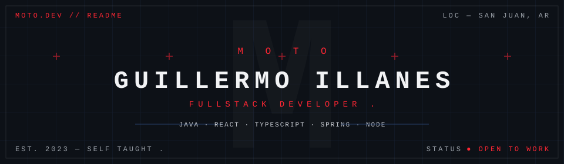
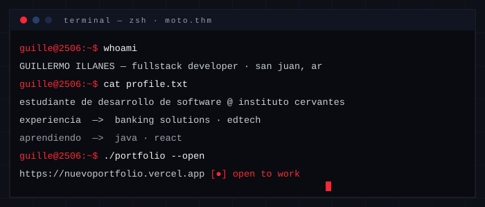
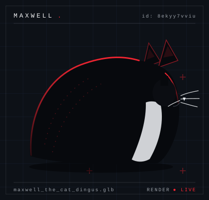
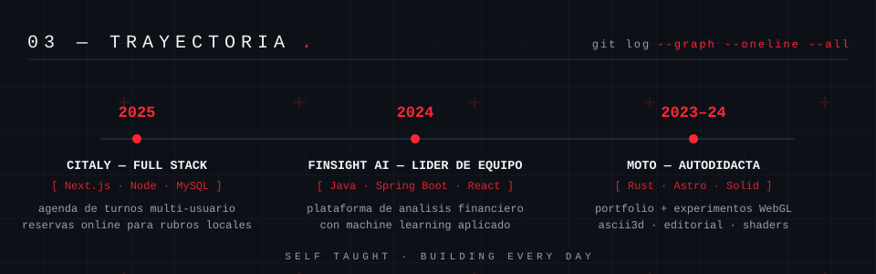



 

## `$ whoami`

<table>
  <tr>
    <td width="66%" valign="top">
      
    </td>
    <td width="34%" valign="middle">
      
    </td>
  </tr>
</table>

## `$ cat stack.yaml`

<table>
  <tr><td valign="top" width="24%"><b>FRONTEND</b></td><td></td></tr>
  <tr><td valign="top"><b>BACKEND</b></td><td></td></tr>
  <tr><td valign="top"><b>DATABASE</b></td><td></td></tr>
  <tr><td valign="top"><b>TOOLS</b></td><td></td></tr>
</table>

## `$ git log --trayectoria`

## `$ gh api stats`

  
  

  

## `$ ls works/`

<table>
  <tr>
    <td width="33%" valign="top">
      
      <b>FINSIGHT AI</b> - [ Java / IA / Machine Learning ]
    </td>
    <td width="33%" valign="top">
      
      <b>CITALY</b> - [ Next.js / Node / MySQL ]
    </td>
    <td width="33%" valign="top">
      
      <b>PACKALL SRL</b> - [ Java / Web Corporativa ]
    </td>
  </tr>
</table>

<b>GRACIAS POR VISITAR MI PERFIL</b> 

  

<i>guiada por la estetica MOTO: blueprint oscuro, un unico acento rojo, tipografia mono.</i>

